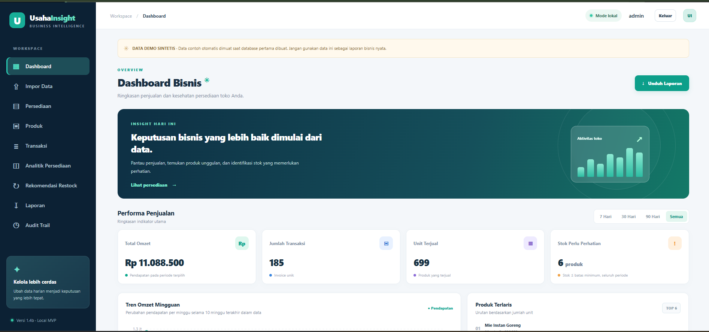
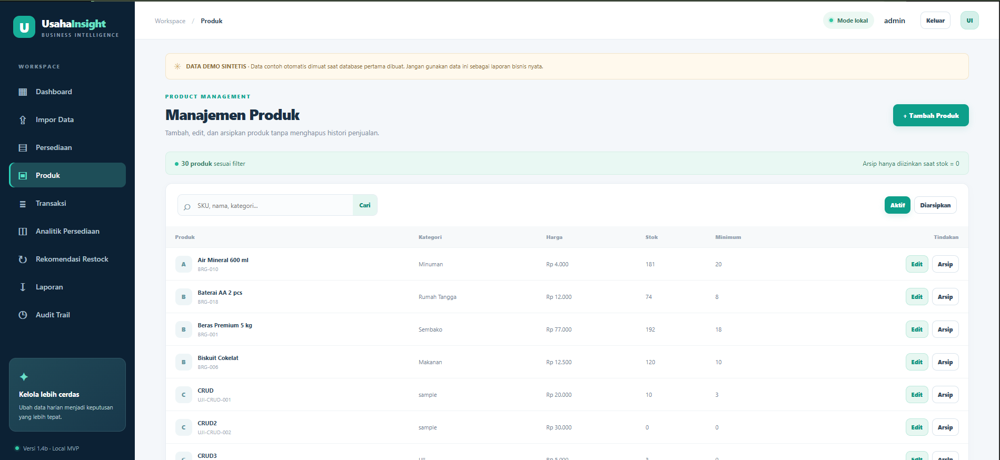
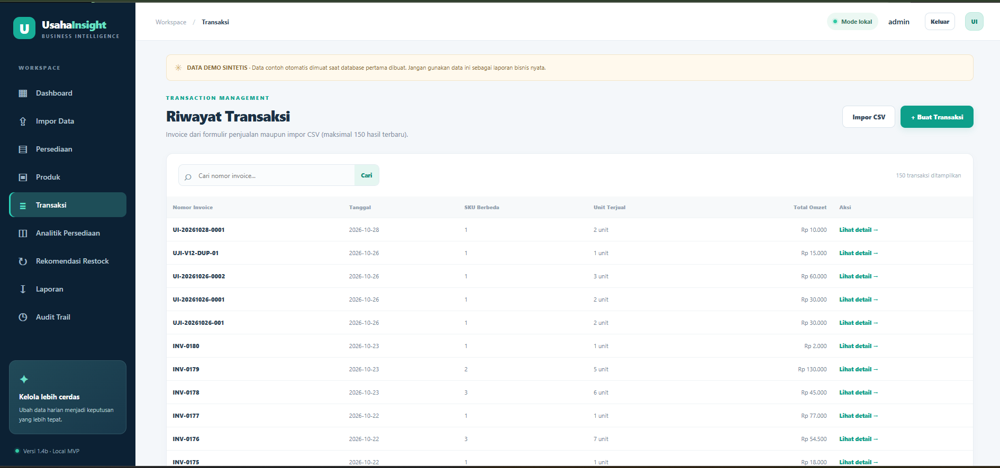
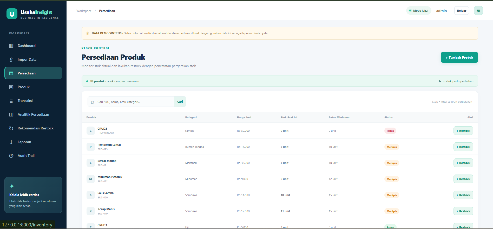
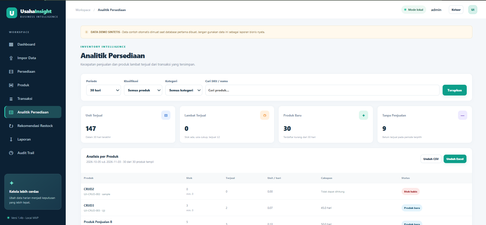
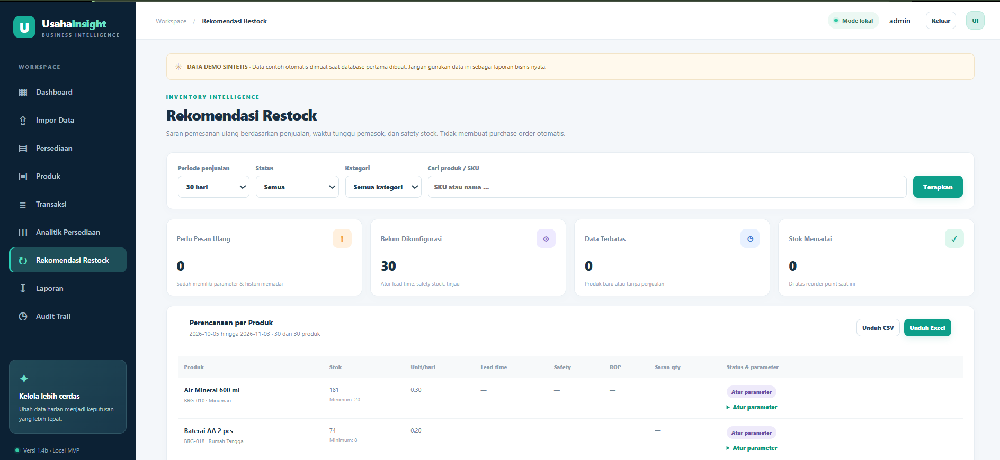
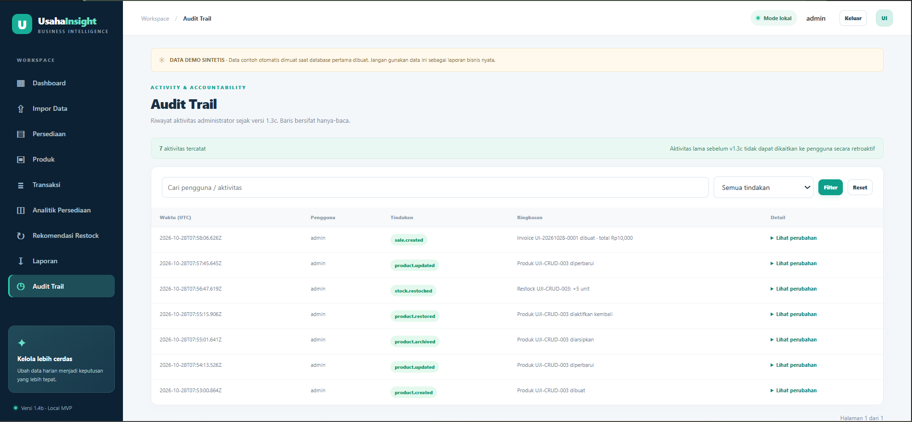
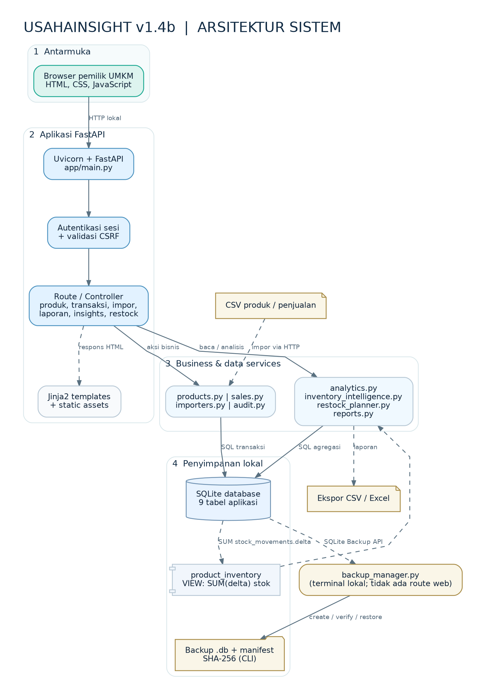
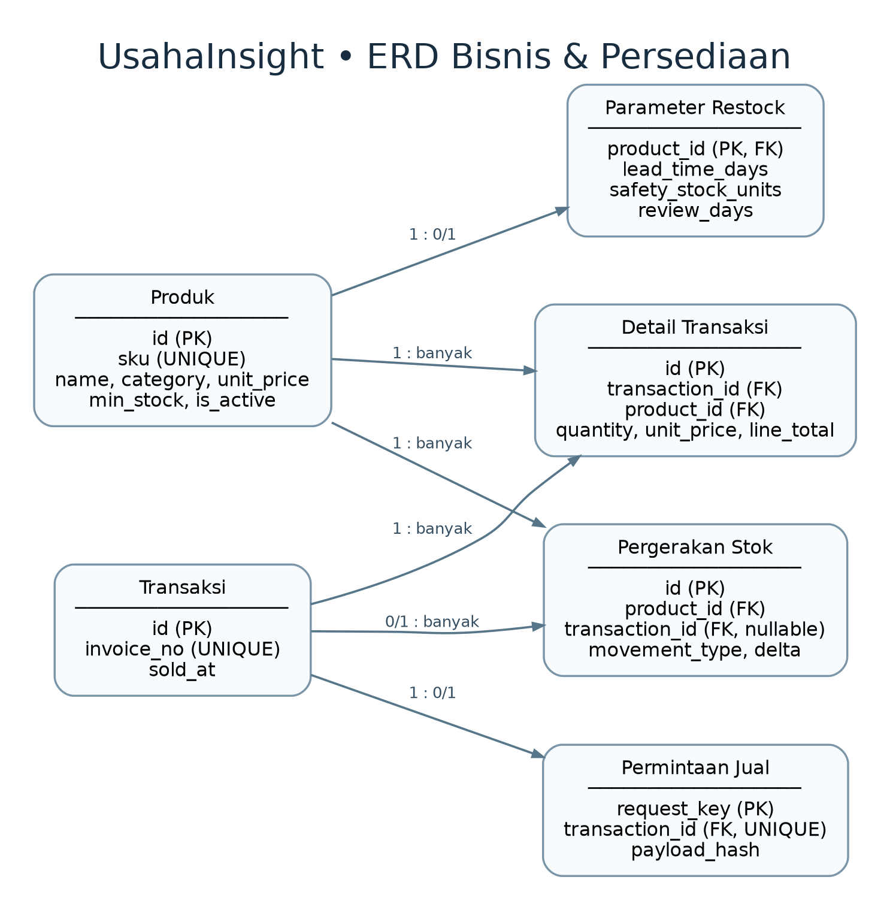
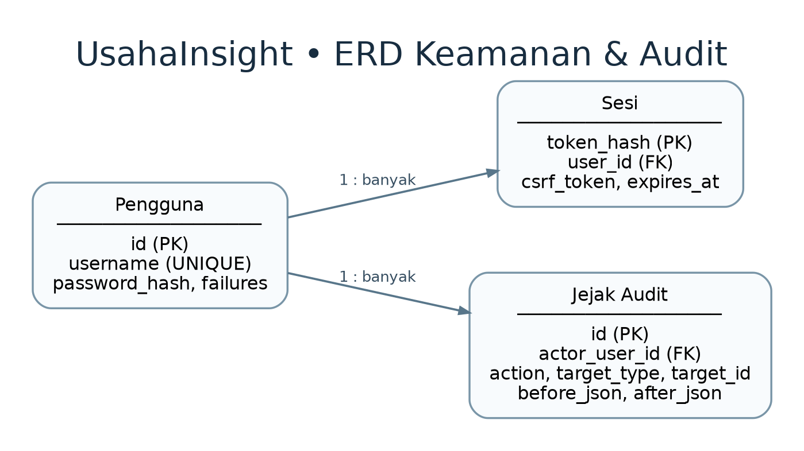

# UsahaInsight — Sales & Inventory Analytics for UMKM

**Local-first web application for small retail businesses.** UsahaInsight turns daily sales and stock records into actionable insights: sales trends, product movement, inventory warnings, and transparent restocking recommendations.

> **Portfolio status:** v1.4b feature baseline; v2.0 documentation and portfolio release in preparation. The application is designed for **local, single-admin demonstration**, not an Internet-facing production service.
>
> **Data disclosure:** bundled example sales and products are **synthetic demo data**, not real UMKM records. Screenshots in this repository should also show synthetic data.

## Overview

A small shop may use spreadsheets to track product inventories and sales. UsahaInsight provides a connected workflow for registering products, recording multi-item sales, tracking each stock movement, analyzing past demand, and reviewing suggested reorder quantities.

**Who is it for?** Single-shop operators, small retail business owners, and students learning how to translate business requirements into a tested information system.

## Screenshots

> Add the seven screenshots you collected into `docs/screenshots/` using the **exact filenames** below before publishing the repository. Screenshots are not included in this documentation update.

| Dashboard | Products |
|---|---|
|  |  |

| Record sale | Inventory |
|---|---|
|  |  |

| Inventory analytics | Restock recommendations |
|---|---|
|  |  |



## Core features

| Area | Capabilities |
|---|---|
| Data onboarding | CSV import with schema, duplicate, SKU, date, quantity and consistency validation |
| Product catalog | Create, edit, archive and reactivate products; uniqueness checks for SKU |
| Sales | Multi-product invoice entry, stock checks, atomic transactions and duplicate-submit protection |
| Inventory | Stock movement ledger, low-stock indicators, and restocking |
| Sales dashboard | Revenue, transactions, units sold, product performance, weekly trends |
| Reporting | Date filters and CSV / Excel exports |
| Authentication | Local administrator login, Argon2id password hashing, server-side sessions, logout and CSRF protection |
| Audit Trail | Records relevant product, sales, restock and settings changes with actor and timestamp |
| Backup and recovery | Local SQLite snapshots, hash/integrity validation and restore sandbox verification |
| Inventory intelligence | 7/30/90-day sales velocity, stock coverage, and slow-moving classification |
| Restock planner | Lead time, safety stock and review interval; explainable reorder points and suggested quantities |

## Technical stack

- **Backend:** Python, FastAPI, Uvicorn
- **Web UI:** server-rendered Jinja2 templates, HTML, CSS and vanilla JavaScript
- **Database:** SQLite with explicit transactions and SQL constraints
- **Data/exports:** pandas, openpyxl, CSV
- **Authentication:** Argon2id (`argon2-cffi`), revocable server-side sessions, CSRF checks
- **Testing:** pytest and HTTPX
- **Developer tools:** PyCharm, Git, SQLite database console

No Streamlit or Node.js build step is required.

## Architecture and data model



**Business & inventory ERD**



**Security & audit ERD**



For detailed design and traceability, see:

- [Database design and data dictionary](docs/DATABASE_DESIGN_V2.md)
- [System architecture](docs/SYSTEM_ARCHITECTURE_V2.md)
- [Business processes](docs/BUSINESS_PROCESS_V2.md)
- [Analytics methodology](docs/ANALYTICS_PIPELINE_V2.md)
- [Architecture / implementation traceability](docs/TRACEABILITY_ARCHITECTURE_V2.md)

## Run locally (Windows)

Requirements: **Python 3.10+**, a terminal (PowerShell), and internet access for initial dependency installation.

```powershell
py -3 -m venv .venv
.\.venv\Scripts\python.exe -m pip install -r requirements.txt
.\.venv\Scripts\python.exe auth_manager.py init-admin --username admin
.\.venv\Scripts\python.exe run.py
```

Open **http://127.0.0.1:8000/login** and sign in with the password you created. There is **no hardcoded default password**. Password characters may be invisible in the terminal by design.

The first startup initializes the local SQLite database. A new empty installation is populated with **clearly labeled synthetic demo data** unless the empty-start marker is configured; existing database data is not intentionally replaced by startup seeding.

Stop the server with `Ctrl+C`. For the one-click Windows runner, `run_windows.bat` is also available, but **an admin account must be created via the command above** before logging in.

### macOS / Linux

```bash
python3 -m venv .venv
./.venv/bin/python -m pip install -r requirements.txt
./.venv/bin/python auth_manager.py init-admin --username admin
./.venv/bin/python run.py
```

This is for local development. Do not expose the development configuration directly to the public Internet.

## Automated testing

```powershell
.\.venv\Scripts\python.exe -m pip install -r requirements-dev.txt
.\.venv\Scripts\python.exe -m pytest -q
```

**Latest reported local baseline:** **114 automated tests passed** on v1.4b. Manual acceptance tests **TC61–TC68: 8/8 passed**; prior milestones were also tested during development. These are reported test outcomes, not a guarantee of bug-free or production-grade behavior. See [release checklist](docs/PORTFOLIO_RELEASE_CHECKLIST_V2.md).

## Analytics methodology

- **Sales velocity** = units sold within the selected 7/30/90-day window ÷ number of days.
- **Stock coverage** = available stock ÷ sales velocity; unavailable where sales velocity is not positive.
- **Slow-moving** = positive stock + full observation window since product creation + at most two units sold in that period.
- **Reorder point** = ceiling(sales velocity × supplier lead time) + safety stock.
- **Suggested quantity** estimates demand during lead time + review period, minus current stock, with a safety-stock allowance.

The restock recommendation is **advisory, not ML forecasting**. Products with insufficient data or missing supplier settings are not assigned misleading purchase quantities. Full assumptions: [Analytics pipeline](docs/ANALYTICS_PIPELINE_V2.md).

## Security, data privacy, and limitations

- This release is designed for **local single-admin use**. Do not deploy publicly without an independent security and deployment review (HTTPS, secure cookies, secrets, production runtime, recovery and access controls).
- Database files, authentication records, sessions, backups, environment secrets, test sandboxes, and user data are **excluded from version control**.
- Bundled CSV examples are synthetic; do not upload operational customer/sales data from a real shop without authorization.
- No supplier purchase-order execution, demand uncertainty modeling, seasonal forecasting, multi-tenant isolation or advanced user roles.
- Activity history is helpful for application accountability but is not a tamper-proof forensic audit log against a person with direct database-file access.

## Project documentation

- [GitHub publishing guide](docs/GITHUB_PUBLISH_V2.md)
- [Release checklist](docs/PORTFOLIO_RELEASE_CHECKLIST_V2.md)
- [Demo flow](docs/DEMO_SCRIPT_V2.md)

## License

MIT — see [LICENSE](LICENSE). This educational code portfolio is not a guarantee of production suitability.
