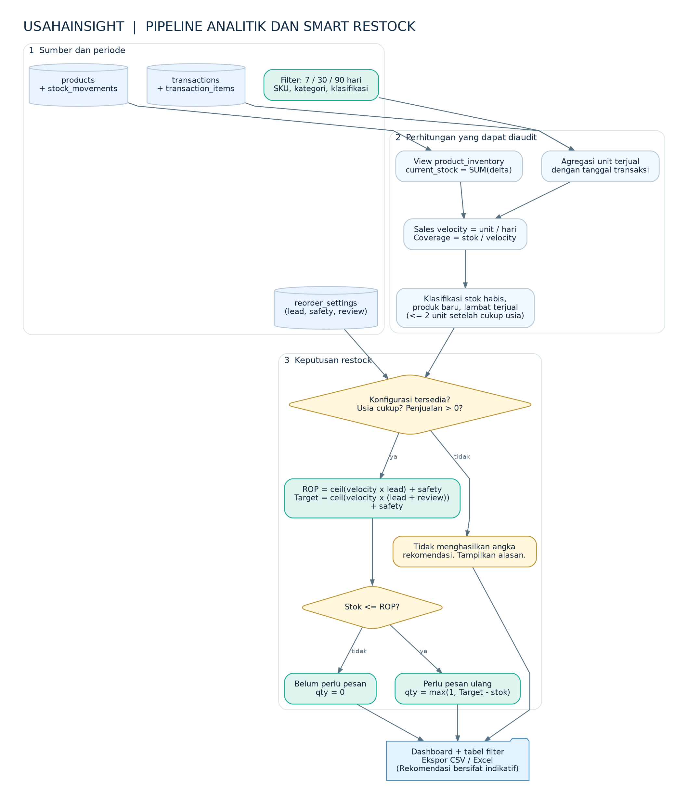

# Metodologi Analitik dan Smart Restock — UsahaInsight v1.4b

## 1. Sumber data dan periode

Analitik menggunakan `transactions.sold_at` untuk batas waktu dan `transaction_items` untuk unit/omzet, lalu menggabungkannya dengan `products` dan view `product_inventory`. Pengguna memilih periode **7, 30, atau 90 hari**; transaksi bertanggal masa depan tidak masuk hitungan analitik. Konfigurasi restock berada pada `reorder_settings`.

## 2. Rumus yang dijalankan

| Ukuran | Definisi | Catatan |
|---|---|---|
| Unit terjual | `SUM(transaction_items.quantity)` dalam periode | Kumpulkan per produk |
| Pendapatan | `SUM(transaction_items.line_total)` | Harga historis per invoice |
| Stok tersedia | `SUM(stock_movements.delta)` per produk | Disediakan view `product_inventory` |
| Sales velocity | `units_sold / days` | Per hari kalender pada periode pilihan |
| Stock coverage | `current_stock / velocity` | `None` jika tidak ada velocity positif atau stok = 0 |
| Slow-moving | stok > 0, umur produk ≥ periode, unit terjual ≤ 2 | Aturan sederhana, bukan clustering/ML |
| Reorder point | `ceil(velocity × lead_time_days) + safety_stock_units` | Unit harus bilangan bulat |
| Target stok | `ceil(velocity × (lead_time_days + review_days)) + safety_stock_units` | Asumsi laju konstan |
| Saran pembelian saat perlu pesan | `max(1, target_stock − current_stock)` | Hanya jika stok ≤ ROP dan data cukup |
| Saran pembelian saat stok cukup | `0` | Stok > ROP |

**Contoh ilustratif:** 60 unit terjual dalam 30 hari, stok sekarang 10, lead time 5 hari, safety 3 unit dan review 7 hari menghasilkan velocity 2, ROP 13 unit dan rekomendasi pembelian 17 unit. Ini bukan angka dari database pengguna.

## 3. Kapan saran pembelian tidak diberikan?

- **Belum dikonfigurasi:** parameter lead time, safety stock, periode tinjau belum diisi.
- **Produk baru:** usia pencatatan kurang dari jendela 7/30/90 hari yang dipilih.
- **Belum ada penjualan:** unit terjual = 0, sehingga angka pembelian tidak diada-adakan.

Pada kondisi tersebut, halaman menampilkan alasan dan mengarahkan pemilik untuk mengevaluasi stok minimum secara manual. Sistem tidak melakukan purchase order atau pembelian otomatis.

## 4. Antarmuka dan ekspor

- `/insights`: filter SKU, kategori dan klasifikasi, ditambah ekspor CSV/XLSX.
- `/restock-planner`: parameter pemasok per produk, status rekomendasi, filter, ekspor CSV/XLSX.
- Perubahan pengaturan restock menghasilkan event `reorder.settings_updated` pada Audit Trail jika memang berubah.
- `/reports` memakai analisis slow-moving yang konsisten dari service analitik.

## 5. Batasan metodologis

Velocity dan coverage merupakan ukuran deskriptif berbasis histori, **bukan prediksi permintaan**. Tidak menghitung ketidakpastian musiman, stok incoming, retur, biaya beli, atau batas minimum pembelian pemasok. Parameter lead time dan safety stock diisi admin; rekomendasi harus divalidasi terhadap kondisi bisnis aktual.

## 6. Uji yang relevan

- `tests/test_insights.py` serta manual TC51–TC59: periode, klasifikasi, kecepatan, cakupan, penjualan nol, filter, ekspor.
- `tests/test_restock_planner.py` serta manual TC61–TC68: angka ROP, saran pembelian, parameter, audit, ekspor, regresi.
