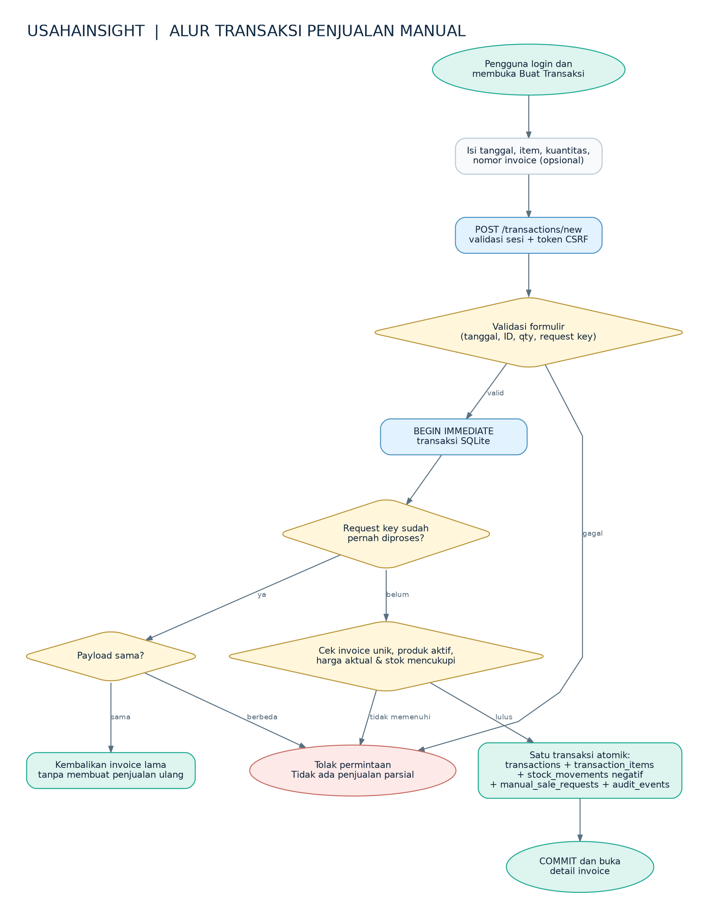
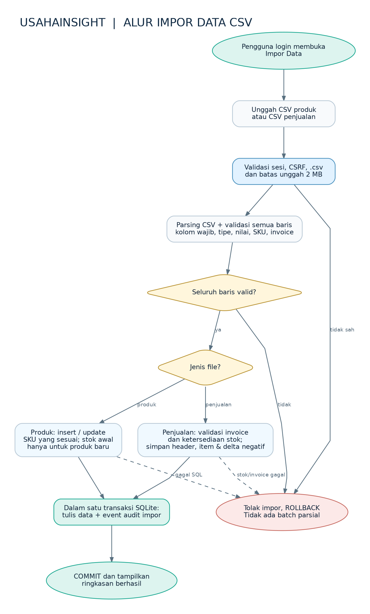

# Dokumentasi Proses Bisnis — UsahaInsight v1.4b

Dokumen ini mendeskripsikan alur yang berjalan pada aplikasi saat ini. Aktor utama ialah administrator/pemilik UMKM yang telah login.

## A. Penjualan langsung (multi-produk)

**Pra-kondisi:** administrator login; produk aktif dan memiliki stok cukup; server berfungsi; database tersedia.

| Langkah | Perilaku sistem | Implementasi / bukti |
|---|---|---|
| 1 | Pengguna memilih item, jumlah, tanggal dan invoice opsional | `GET /transactions/new`, template `sale_form.html` |
| 2 | Sistem memeriksa sesi, CSRF, format tanggal/kuantitas, dan request key | `app/main.py`, `app/services/sales.py` |
| 3 | Transaksi SQLite dikunci dengan `BEGIN IMMEDIATE` untuk pemeriksaan dan tulis yang konsisten | `create_sale()` |
| 4 | Jika request key sama dan payload sama, nomor invoice sebelumnya dikembalikan | `manual_sale_requests` |
| 5 | Produk harus aktif; stok harus cukup; harga diambil kembali dari katalog pada saat penyimpanan | `create_sale()` dan `product_inventory` |
| 6 | Sistem menyimpan header, item, delta stok negatif, request key, dan audit dalam satu transaksi | `transactions`, `transaction_items`, `stock_movements`, `manual_sale_requests`, `audit_events` |
| 7 | Setelah commit, pengguna membuka detail invoice; dashboard dan laporan membaca data baru | `/transactions/{id}`, `/`, `/reports` |

**Jika gagal:** request tidak valid, invoice sudah ada, produk tidak aktif, stok tidak cukup, request key dipakai untuk payload berbeda, atau kegagalan SQL → sistem menolak, transaksi dibatalkan, tidak ada stok negatif atau invoice parsial yang sah.

**Aturan bisnis:** satu produk hanya satu kali per invoice; semua nilai Rupiah disimpan sebagai integer; audit penjualan tercatat hanya untuk aksi yang berhasil.

## B. Impor CSV dan validasi

1. Pengguna memilih file CSV katalog produk atau transaksi melalui `/imports`.
2. Sistem memeriksa sesi/login, token CSRF, ekstensi `.csv`, ukuran upload maksimum 2 MB, header wajib dan format setiap baris.
3. Untuk **produk**, sistem membuat SKU baru atau memperbarui data katalog sesuai aturan import. Stok awal hanya diterapkan pada produk baru.
4. Untuk **penjualan**, sistem memeriksa SKU, invoice/duplikasi, jumlah, dan stok yang tersedia; transaksi dan pergerakan stok disimpan konsisten.
5. Jika semua data sah, transaksi di-commit serta satu event audit impor dicatat. Jika ada kesalahan validasi, batch dibatalkan.

**Kontrol penting:** jangan gunakan CSV uji pada database produksi; jangan mengimpor ulang data sembarangan. Simpan data contoh sebagai sintetis, bukan data bisnis nyata.

## C. Restock manual

- Administrator memilih produk di `/inventory` dan memasukkan kuantitas restock.
- `importers.restock()` menambah baris `stock_movements` dengan `delta` positif dan mencatat `stock.restocked` melalui `write_audit()`.
- View `product_inventory` menghitung stok terbaru dari seluruh ledger; restock **tidak** menambah omzet atau transaksi penjualan.

## D. Pengelolaan produk

- Produk baru dibuat dengan SKU unik, nama, kategori, harga dan minimum stok.
- Edit produk tidak mengubah harga historis pada `transaction_items`.
- Produk dapat diarsipkan dan diaktifkan kembali dengan aturan yang memelihara histori. Arsip bukan penghapusan permanen.
- Operasi bisnis dari sesi admin yang berhasil dicatat melalui Audit Trail.

## E. Pengujian dan ketertelusuran

| Perilaku | Bukti pengujian yang dapat ditautkan |
|---|---|
| Penjualan multi-item, stok turun, invoice duplikat ditolak | `tests/test_sales.py`, hasil TC21–TC26 |
| Audit aktor, transaksi gagal tanpa audit semu | `tests/test_audit.py`, TC41–TC49 |
| Perilaku impor dan restock | `tests/test_app.py`, TC01–TC05 |
| Login, logout, CSRF dan sesi | `tests/test_auth.py`, `tests/test_login_cookie_fix.py` |

Bukti kelulusan manual adalah hasil yang dicatat pengguna saat acceptance testing. Pastikan file `test-reports/` aktual disimpan terpisah saat persiapan rilis.
