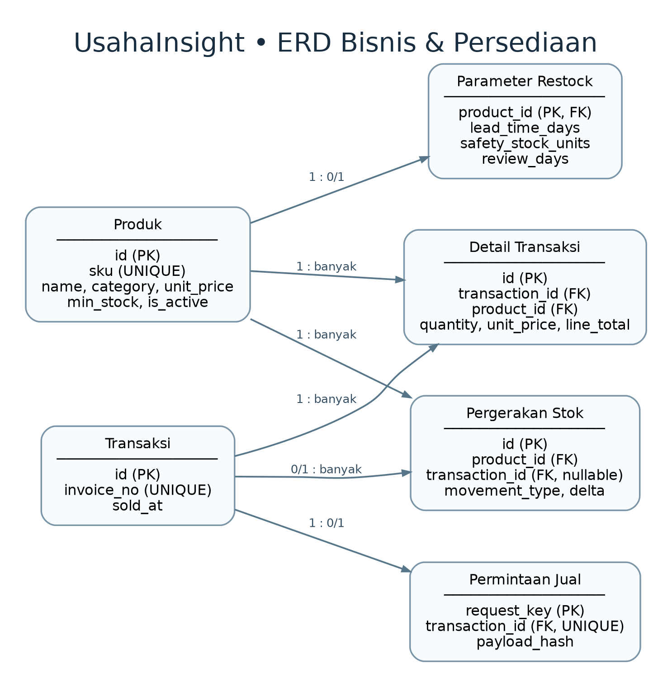
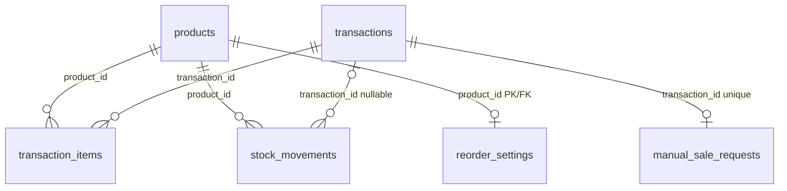
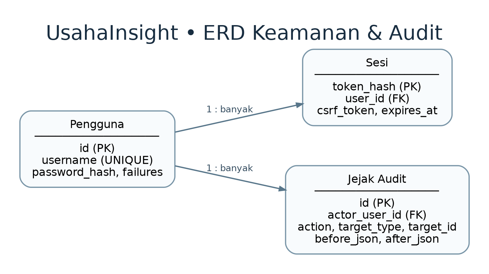
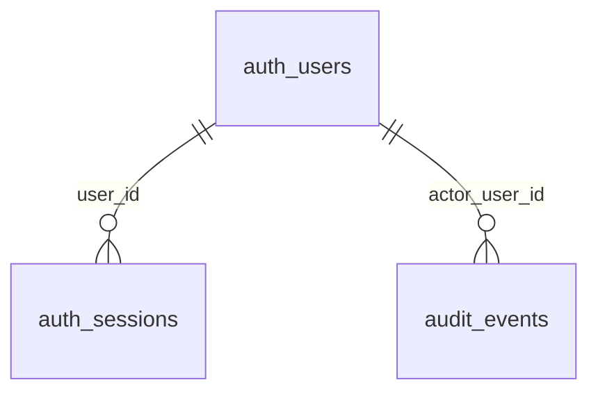

# Desain Database & ERD — UsahaInsight v1.4b (persiapan v2.0)

**Status dokumen:** rancangan berbasis *source code* versi v1.4b (`app/schema.sql`, migrasi pada `app/database.py`, tabel autentikasi pada `app/services/auth.py`). **Periksa skema database yang benar-benar terhubung di PyCharm sebelum menjadikan ini ERD final proyekmu.**

## Ringkasan arsitektur data

- **9 tabel aplikasi**: `products`, `transactions`, `transaction_items`, `stock_movements`, `manual_sale_requests`, `reorder_settings`, `auth_users`, `auth_sessions`, `audit_events`.
- **1 view**: `product_inventory`, menghitung `current_stock` dari jumlah `stock_movements.delta` per produk. View **bukan** tabel penyimpanan stok terpisah.
- **2 tabel internal SQLite** (`sqlite_master`, `sqlite_sequence`) bukan entitas bisnis dan tidak masuk ERD final.
- Harga dan subtotal disimpan sebagai **INTEGER** (rupiah, tanpa pecahan), bukan angka float.
- Kolom `products.is_active` ditambahkan melalui migrasi di `app/database.py`, sehingga tidak terlihat di definisi awal `CREATE TABLE products`.

> **Pemeriksaan penting:** gambar PyCharm sebelumnya menampilkan 8 tabel aplikasi. Sementara kode v1.4b menambahkan tabel `reorder_settings`, sehingga targetnya 9. Jalankan query pada `docs/DB_VERIFICATION.sql` untuk mengonfirmasi lokasi file database, tabel, dan view. Bila `reorder_settings` belum terlihat, jangan langsung mengubah database: pastikan konsol membaca file yang benar, *refresh* metadata, dan bahwa aplikasi v1.4b pernah dimulai pada file itu.

## ERD 1 — Data bisnis dan persediaan

**Pembacaan hubungan:**

- Satu produk dapat muncul dalam banyak item transaksi dan banyak pergerakan stok; pengurangan/penambahan dihitung dari ledger.
- Satu transaksi terdiri atas beberapa `transaction_items`. Ada constraint `UNIQUE(transaction_id, product_id)` untuk mencegah produk sama muncul dua kali pada satu invoice.
- `stock_movements.transaction_id` **boleh NULL**: stok awal atau restock tidak selalu berhubungan dengan transaksi penjualan.
- `manual_sale_requests` adalah catatan idempotensi. Satu transaksi bisa mempunyai **nol atau satu** catatan permintaan penjualan manual, bukan selalu satu.
- `reorder_settings.product_id` adalah **PK sekaligus FK**: setiap produk mempunyai paling banyak satu konfigurasi perencanaan restock.

## ERD 2 — Identitas, sesi dan audit

**Penting:** `audit_events.target_type` dan `target_id` menunjukkan objek yang berubah secara logis; **`target_id` bukan foreign key** ke tabel produk, transaksi, atau stok. Jangan menggambar garis FK untuk kolom tersebut. Update/delete audit dicegah oleh trigger aplikasi pada SQLite; pemegang akses penuh ke file tetap dapat memodifikasi database.

## View analitik — bukan tabel transaksi

`product_inventory` menggabungkan `products` dengan agregasi `SUM(stock_movements.delta)`, menggunakan `COALESCE` saat produk belum mempunyai pergerakan. View ini dipakai sebagai lapisan baca persediaan, sehingga tidak perlu digambarkan sebagai tabel dengan FK baru.

## Kamus data

### `audit_events`

Jejak perubahan bisnis, pengguna, tindakan, dan nilai sebelum/sesudah.

| Kolom | Tipe SQLite | Kunci | Catatan |
|---|---|---|---|
| `id` | `INTEGER` | PK | — |
| `actor_user_id` | `INTEGER` | FK → `auth_users.id` | NOT NULL |
| `actor_username` | `TEXT` | — | NOT NULL |
| `action` | `TEXT` | — | NOT NULL |
| `target_type` | `TEXT` | — | NOT NULL |
| `target_id` | `INTEGER` | — | — |
| `before_json` | `TEXT` | — | — |
| `after_json` | `TEXT` | — | — |
| `summary` | `TEXT` | — | NOT NULL; DEFAULT '' |
| `created_at` | `TEXT` | — | NOT NULL; DEFAULT strftime('%Y-%m-%dT%H:%M:%fZ','now') |

### `auth_sessions`

Sesi login yang dapat dicabut dan token CSRF untuk sesi.

| Kolom | Tipe SQLite | Kunci | Catatan |
|---|---|---|---|
| `token_hash` | `TEXT` | PK | — |
| `user_id` | `INTEGER` | FK → `auth_users.id` | NOT NULL |
| `csrf_token` | `TEXT` | — | NOT NULL |
| `expires_at` | `TEXT` | — | NOT NULL |
| `created_at` | `TEXT` | — | NOT NULL |

### `auth_users`

Akun administrator dan hash password Argon2id.

| Kolom | Tipe SQLite | Kunci | Catatan |
|---|---|---|---|
| `id` | `INTEGER` | PK | — |
| `username` | `TEXT` | — | NOT NULL |
| `password_hash` | `TEXT` | — | NOT NULL |
| `failures` | `INTEGER` | — | NOT NULL; DEFAULT 0 |
| `locked_until` | `TEXT` | — | — |
| `created_at` | `TEXT` | — | NOT NULL; DEFAULT datetime('now') |

### `manual_sale_requests`

Kunci idempotensi formulir penjualan untuk mencegah duplikasi.

| Kolom | Tipe SQLite | Kunci | Catatan |
|---|---|---|---|
| `request_key` | `TEXT` | PK | — |
| `payload_hash` | `TEXT` | — | NOT NULL |
| `transaction_id` | `INTEGER` | FK → `transactions.id` | NOT NULL |
| `created_at` | `TEXT` | — | NOT NULL; DEFAULT datetime('now') |

### `products`

Katalog SKU, harga, batas minimum, status aktif dan waktu pembaruan.

| Kolom | Tipe SQLite | Kunci | Catatan |
|---|---|---|---|
| `id` | `INTEGER` | PK | — |
| `sku` | `TEXT` | — | NOT NULL |
| `name` | `TEXT` | — | NOT NULL |
| `category` | `TEXT` | — | NOT NULL |
| `unit_price` | `INTEGER` | — | NOT NULL |
| `min_stock` | `INTEGER` | — | NOT NULL; DEFAULT 0 |
| `created_at` | `TEXT` | — | NOT NULL; DEFAULT datetime('now') |
| `updated_at` | `TEXT` | — | NOT NULL; DEFAULT datetime('now') |
| `is_active` | `INTEGER` | — | NOT NULL; DEFAULT 1 |

### `reorder_settings`

Konfigurasi lead time, safety stock, dan hari tinjau tiap produk.

| Kolom | Tipe SQLite | Kunci | Catatan |
|---|---|---|---|
| `product_id` | `INTEGER` | PK, FK → `products.id` | — |
| `lead_time_days` | `INTEGER` | — | NOT NULL |
| `safety_stock_units` | `INTEGER` | — | NOT NULL |
| `review_days` | `INTEGER` | — | NOT NULL |
| `updated_at` | `TEXT` | — | NOT NULL; DEFAULT datetime('now') |

### `stock_movements`

Ledger penambahan dan pengurangan stok; delta membentuk stok akhir.

| Kolom | Tipe SQLite | Kunci | Catatan |
|---|---|---|---|
| `id` | `INTEGER` | PK | — |
| `product_id` | `INTEGER` | FK → `products.id` | NOT NULL |
| `transaction_id` | `INTEGER` | FK → `transactions.id` | — |
| `movement_type` | `TEXT` | — | NOT NULL |
| `delta` | `INTEGER` | — | NOT NULL |
| `note` | `TEXT` | — | NOT NULL; DEFAULT '' |
| `created_at` | `TEXT` | — | NOT NULL; DEFAULT datetime('now') |

### `transaction_items`

Rincian produk, kuantitas, harga saat jual, subtotal.

| Kolom | Tipe SQLite | Kunci | Catatan |
|---|---|---|---|
| `id` | `INTEGER` | PK | — |
| `transaction_id` | `INTEGER` | FK → `transactions.id` | NOT NULL |
| `product_id` | `INTEGER` | FK → `products.id` | NOT NULL |
| `quantity` | `INTEGER` | — | NOT NULL |
| `unit_price` | `INTEGER` | — | NOT NULL |
| `line_total` | `INTEGER` | — | NOT NULL |

### `transactions`

Header invoice penjualan dan tanggal transaksi.

| Kolom | Tipe SQLite | Kunci | Catatan |
|---|---|---|---|
| `id` | `INTEGER` | PK | — |
| `invoice_no` | `TEXT` | — | NOT NULL |
| `sold_at` | `TEXT` | — | NOT NULL |
| `created_at` | `TEXT` | — | NOT NULL; DEFAULT datetime('now') |

## Catatan integritas

- Foreign key diaktifkan **per koneksi** melalui `PRAGMA foreign_keys = ON` pada `app/database.py`; tidak cukup hanya membuat deklarasi `REFERENCES`.
- Nilai kuantitas item harus lebih dari 0, harga tidak boleh negatif; tipe pergerakan stok dibatasi pada `initial`, `sale`, `restock`, `adjustment`.
- `auth_sessions` mempunyai `ON DELETE CASCADE`; relasi FK bisnis yang tercatat memakai `ON DELETE RESTRICT`.
- Perubahan bisnis dan audit ditulis dalam satu transaksi SQLite pada operasi yang diaudit; riwayat sebelum fitur audit tersedia tidak otomatis muncul sebagai event baru.
- **Model ini adalah untuk aplikasi satu toko dengan administrator lokal**. Tidak ada tabel supplier, HPP, pembelian aktual, atau pengiriman barang pada skema ini. Saran restock adalah analitik indikatif, bukan purchase order otomatis.

## Sumber pemeriksaan kode

`app/schema.sql`, `app/database.py`, `app/services/auth.py`, `app/services/inventory_intelligence.py`, `app/services/restock_planner.py`, `app/services/audit.py`.

**Status finalisasi:** periksa `PRAGMA database_list`, jalankan query validasi, perbarui screenshot diagram dari database aktif, lalu catat tanggal dan revisi final dokumen.
