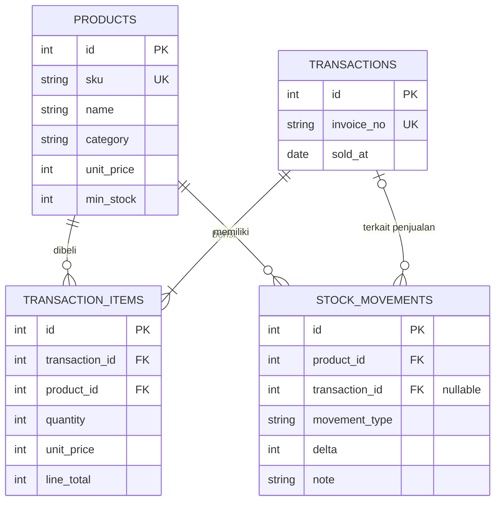

# Entity Relationship Diagram — UsahaInsight

## Peraturan penting

- Omzet = total `transaction_items.line_total` pada tanggal transaksi yang dipilih.
- Harga penjualan disimpan per item transaksi; perubahan harga master produk **tidak** mengubah omzet historis.
- Stok saat ini = penjumlahan seluruh `stock_movements.delta` per produk melalui view `product_inventory`.
- `initial` dan `restock` menambah stok; `sale` mengurangi stok; stok tidak boleh menjadi negatif.
- Impor produk dengan SKU yang sudah ada memperbarui katalog, tetapi **tidak** menambahkan ulang stok awal.
- `invoice_no` unik, serta `(transaction_id, product_id)` unik untuk detail; impor ulang invoice dibatalkan.
- Seluruh impor per file bersifat atomik: satu kesalahan membatalkan semua perubahan pada file itu.
- Aplikasi ini dirancang untuk **single-store, local demo**, tanpa autentikasi. Jangan deploy terbuka ke internet tanpa kontrol keamanan dan hak akses.

## v1.2 — Idempotensi transaksi manual

`manual_sale_requests(request_key TEXT PRIMARY KEY, payload_hash TEXT NOT NULL, transaction_id INTEGER NOT NULL UNIQUE REFERENCES transactions(id))` mencatat kunci satu-kali per formulir. Tabel ini **tidak mengganti** `transactions` atau `transaction_items` dan dibuat saat `init_db()` pertama setelah upgrade. Pengiriman ulang kunci dan payload yang sama mengembalikan ID transaksi lama, tidak mengurangi stok lagi. Kunci sama dengan payload berbeda ditolak.
