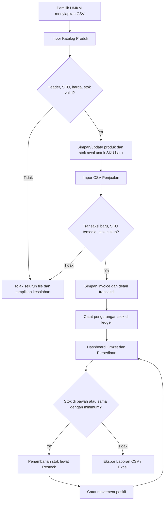

# Proses Bisnis UsahaInsight

## Alur awal

## Business questions

| Pertanyaan bisnis | Implementasi sistem | Cara menguji |
|---|---|---|
| Berapa omzet periode ini? | SUM(line_total) untuk invoice pada rentang tanggal | Uji transaksi dua produk dengan harga berbeda |
| Mana produk terlaris? | SUM(quantity) GROUP BY produk | Periksa unit per SKU terhadap detail transaksi |
| Mana stok menipis? | SUM(stock_movements.delta) ≤ min_stock | Uji restock dan saldo sebelum/sesudah |
| Apakah impor dua kali menggandakan omzet? | Unique invoice + atomic SQL transaction | Uji invoice yang sama dua kali; kedua ditolak |
| Mana produk jarang terjual? | ≤2 unit terjual dalam 30 hari kalender terakhir | Cek kuantitas per SKU dan periode tanggal |

## Pembatasan scope

- Toko tunggal, bukan multi-cabang / multiuser.
- Tidak mencakup pembelian dari supplier, harga pokok penjualan, atau laba bersih.
- Tidak menangani retur barang, penjualan kredit, pajak, atau diskon khusus.
- Stok saat ini berasal dari movement ledger, bukan rekonstruksi saldo historis per transaksi.
- Grafik mingguan menampilkan 10 minggu terakhir yang ditentukan dari tanggal transaksi terkini.
