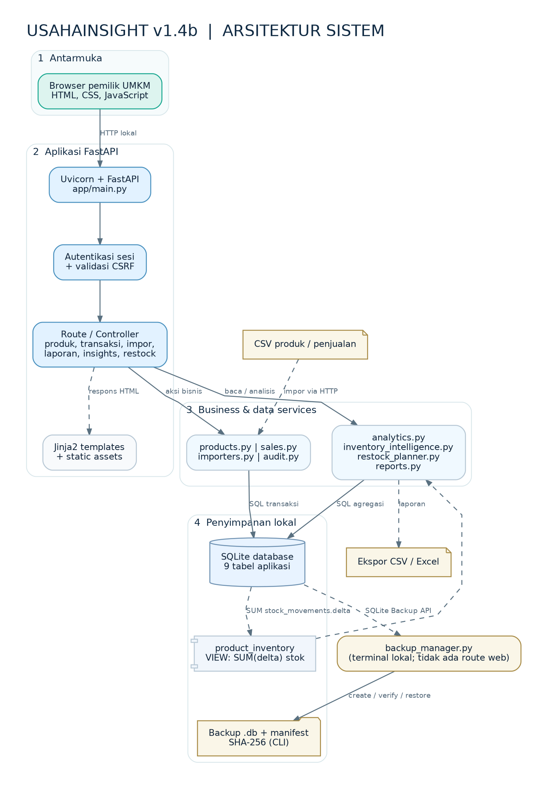

# Arsitektur Sistem — UsahaInsight v1.4b (Dokumentasi v2.0)

**Status:** dokumentasi *as implemented*, disusun dari kode v1.4b; tidak menambahkan komponen cloud atau layanan yang belum ada. **Ruang lingkup:** aplikasi lokal satu administrator dengan FastAPI, Jinja2, SQLite. Dibaca bersama [`DATABASE_DESIGN_V2.md`](DATABASE_DESIGN_V2.md).

## 1. Gambaran ringkas

Pengguna mengakses halaman HTML melalui browser pada server Uvicorn yang menjalankan FastAPI. `app/main.py` menangani rute HTTP, sesi dan pemeriksaan CSRF; halaman dirender menggunakan Jinja2 di `app/templates/` dan aset dari `app/static/`. Layanan domain di `app/services/` memvalidasi masukan, menulis data bisnis atau menghitung analitik. Semua data bisnis tetap berada di berkas SQLite, bukan PostgreSQL atau cloud.

**Komponen dan bukti implementasi**

| Lapisan | Modul/teknologi yang benar-benar ada | Tanggung jawab |
|---|---|---|
| Antarmuka | Browser, `app/templates/*.html`, `app/static/*` | Dashboard, produk, transaksi, impor, laporan, analitik, restock, audit |
| HTTP | `run.py`, `app/main.py`, FastAPI + Uvicorn | Routing GET/POST, respons HTML, unduhan |
| Akses | `app/services/auth.py`, middleware di `app/main.py` | Login, sesi server-side, cookie, CSRF, logout dan pembatasan percobaan |
| Produk & stok | `products.py`, `importers.py` | CRUD/arsip, impor CSV, restock dan validasi stok |
| Penjualan | `sales.py` | Invoice, multi-item, harga dari database, idempotensi request, stok keluar |
| Audit | `audit.py` | Catatan siapa mengubah apa, sebelum/sesudah bila berlaku |
| Dashboard/laporan | `analytics.py`, `reports.py` | KPI, agregasi penjualan, keluaran CSV/XLSX |
| Persediaan | `inventory_intelligence.py`, `restock_planner.py` | Velocity, coverage, slow-moving, parameter dan rekomendasi restock |
| Penyimpanan | `app/database.py`, `app/schema.sql`, `instance/usahainsight.db` | Koneksi SQLite + FK, tabel dan view agregasi stok |
| Backup CLI | `backup_manager.py`, `app/services/backups.py` | Snapshot konsisten SQLite, manifest SHA-256, verifikasi dan pemulihan |

## 2. Arus HTTP dan pengamanan

1. Permintaan masuk melalui Uvicorn ke middleware autentikasi FastAPI.
2. Halaman bisnis, ekspor, dan API schema memerlukan sesi valid; `/login`, `/health`, dan aset statis dikecualikan sesuai kode.
3. Tindakan yang mengubah data melalui formulir dilindungi CSRF. Login menggunakan token formulir dan cookie khusus.
4. Rute memanggil service terkait; service menggunakan query SQL parameterized dan transaksi untuk perubahan bisnis.
5. Rute merender Jinja2 atau mengirim CSV/XLSX sebagai respons, kemudian browser menampilkannya.

**Catatan batas keamanan:** aplikasi masih *local-first*. Cookie secure dapat diatur untuk HTTP lokal, tetapi deployment publik memerlukan konfigurasi HTTPS dan hardening tambahan. Audit SQLite bukan log tahan manipulasi oleh pihak yang memiliki akses langsung ke file database.

## 3. Integritas data

- **Stok** bukan angka yang ditulis ulang dari dashboard. View `product_inventory` menjumlahkan `stock_movements.delta`, sedangkan produk disimpan di `products`.
- **Penjualan manual** dibuat atomik: `transactions`, `transaction_items`, `stock_movements`, `manual_sale_requests`, dan `audit_events` masuk dalam transaksi SQLite yang sama.
- **Idempotensi** mencegah submit ulang formulir membuat invoice kedua untuk request yang sama.
- **Harga historis** disalin ke `transaction_items.unit_price` ketika invoice disimpan, sehingga edit harga katalog tidak menulis ulang invoice lama.
- **Impor CSV** divalidasi sebelum commit; kesalahan membatalkan satu batch, bukan menghasilkan transaksi parsial.
- **Backup** memakai SQLite Backup API beserta manifest untuk pemeriksaan SHA-256 dan integritas. Restore disediakan melalui CLI, bukan halaman web.

## 4. Rute utama

| Fungsionalitas | Rute yang digunakan |
|---|---|
| Login, logout | `GET/POST /login`, `POST /logout` |
| Dashboard | `GET /` |
| Produk dan persediaan | `/products`, `/products/new`, `/products/{id}/edit`, `/inventory` |
| Penjualan langsung | `GET/POST /transactions/new`, `/transactions/{id}` |
| Impor | `/imports`, `/imports/products`, `/imports/sales` |
| Laporan | `/reports`, `/reports/export` |
| Audit Trail | `/audit` |
| Analitik persediaan | `/insights`, `/insights/export` |
| Rekomendasi restock | `/restock-planner`, `/restock-planner/{id}/settings`, `/restock-planner/export` |

## 5. Diagram pendukung

- [Proses penjualan](diagrams/02_alur_transaksi_penjualan.png)
- [Alur impor CSV](diagrams/03_alur_impor_csv.png)
- [Pipeline analitik dan restock](diagrams/04_pipeline_analitik_restock.png)

## 6. Hal yang **belum** diklaim

Belum ada microservices, message queue, API pihak ketiga, multi-tenant, pembayaran elektronik, pemesanan pemasok otomatis, model ML untuk forecasting, atau deployment produksi. Itu bukan bagian dari sistem v1.4b.
